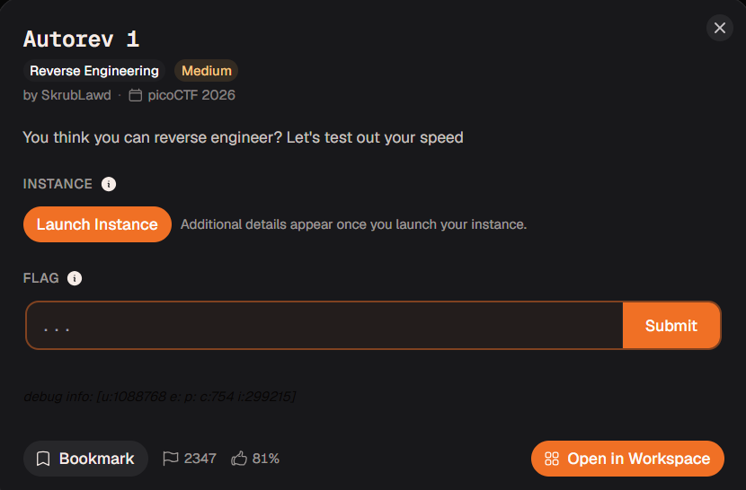
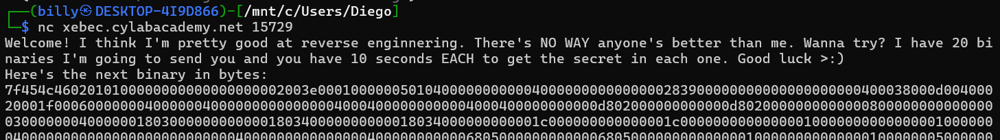
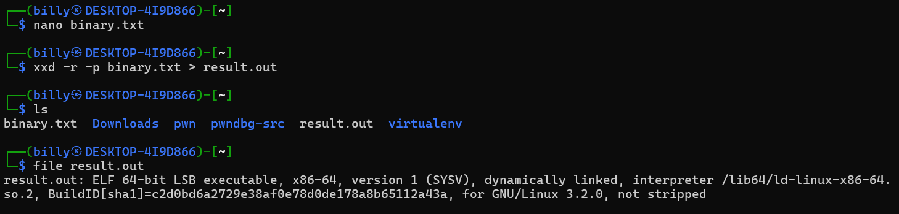
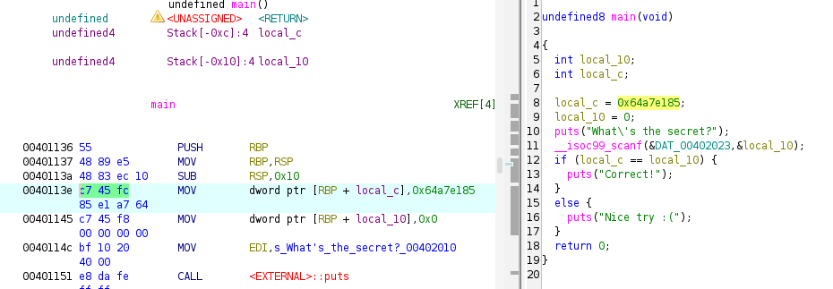
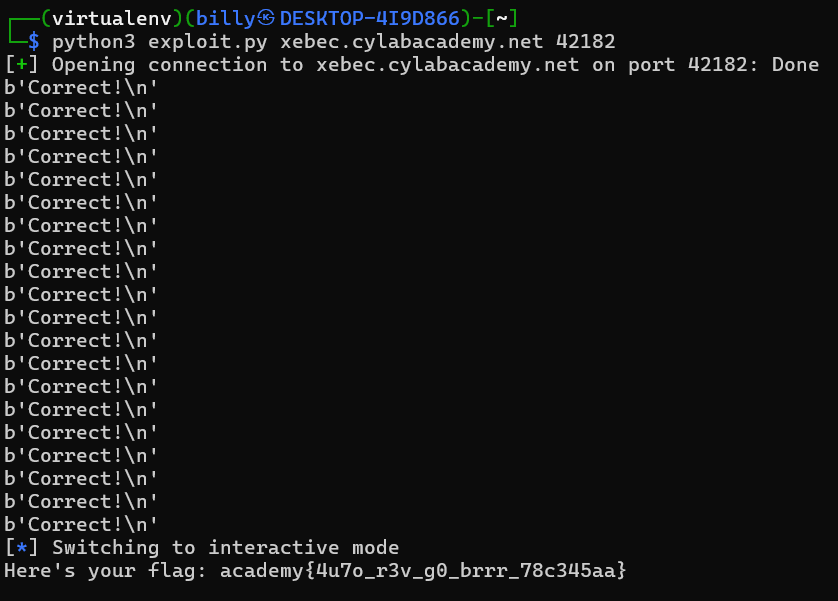

Continuing the series, now it's `autorev 1`'s turn. The category is medium, but it's CyLab-level, so it feels more like an easy CTF.



It works with an instance, so press the button and try to connect to it.



Great, the intro explains it perfectly. It seems that to complete the challenge you need to script every round to get the binary.

```
7f 45 4c 46
```

We can see the magic numbers. Before writing the script to solve the challenge, let's look at what's inside this binary.



Copy all of that into a txt file and use the command:

```bash
xxd -r -p binary.txt > result.out
```

Now you have the ELF, let's look at it in Ghidra.



Pretty straightforward, tbh. Now that we have the secret, you'd want to create the script (we can assume every challenge is going to be the same).

If you try to connect again to the server, it will send you a different secret, so that approach doesn't work.

But this `secret` is just a hardcoded string, so we can search for it directly in the hex string:

```bash
grep -aob c745fc
```

With this command you get the offset. Now you try a simple Python script to check whether the offset actually works:

```python
with open('binary.txt', 'r') as f:
    data = f.read()

print(data[8828:8842])
```

This prints the secret and the signature, so it works. Now we go straight to the script for the challenge:

```python
from pwn import *
import sys

p = remote(sys.argv[1], sys.argv[2])

p.recvuntil(b"bytes:")

while True:
    try:
        chall = p.recvuntil(b"What", drop=True)

        data = bytes.fromhex(chall.decode())

        i = data.find(b"\xc7\x45\xfc")
        secret = int.from_bytes(data[i + 3:i + 7], "little")

        p.sendlineafter(b":", str(secret).encode())
        print(p.recvline())
        p.recvline()

    except EOFError:
        p.interactive()
```


