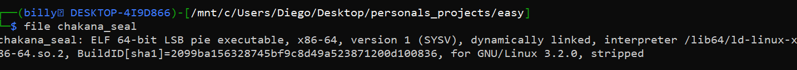
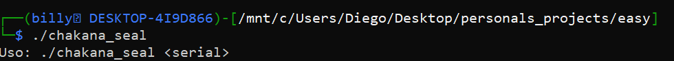
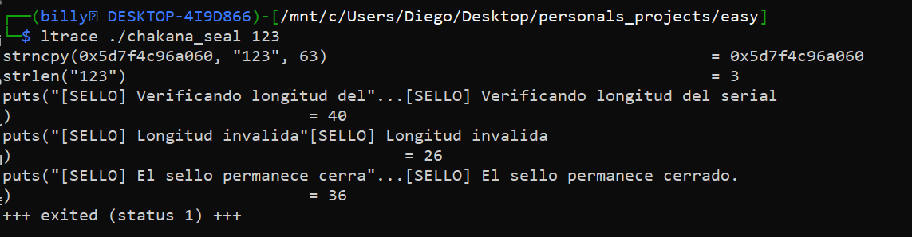
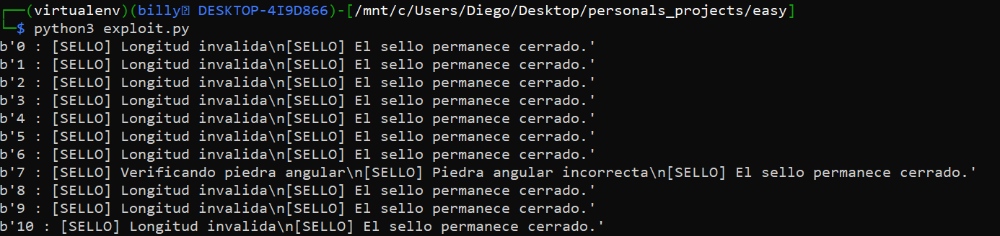
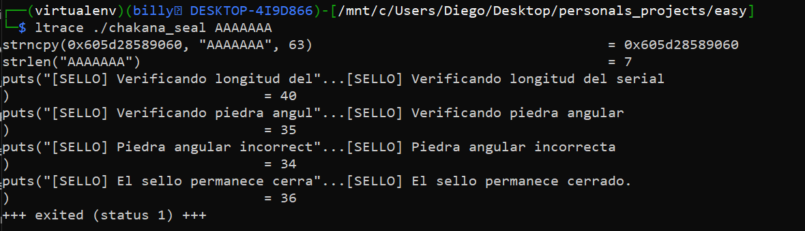
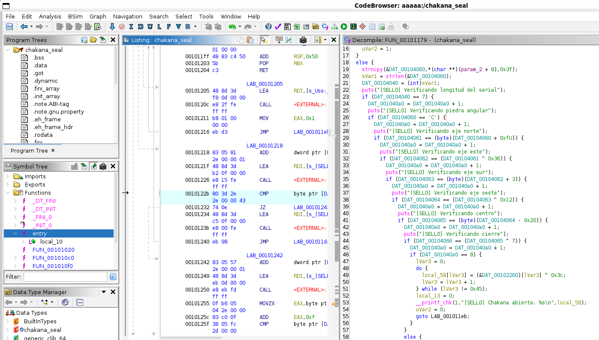
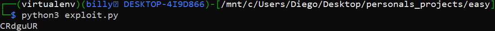
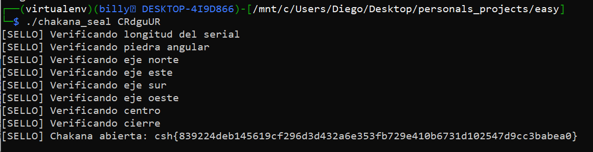

Two weeks ago I took part in a CTF called CSH, organized by UTEC's cybersecurity team. There were plenty of interesting challenges; I focused on reversing and pwn, right now I'm putting more effort into rev while getting the basics of pwn down.

## The challenge

Chakana Seal was an easy reversing problem. First of all we need to look at what kind of file it is.



It's an ELF. Now let's try to run it directly, just to test.



Interesting, we can pass a serial as an argument. The first thing that comes to mind is to try `ltrace`; maybe we can leak the serial.



Nothing important here. But I figured that if we can find the length, there's a chance to get the serial.

To be honest, this can be read directly by opening Ghidra and looking at what's going on, and sometimes `ltrace` is faster, so I tried it that way first, but as we'll see, I was wrong.

```python
from pwn import *

for i in range(64):
    p = process(['./chakana_seal', 'A' * i])
    p.recvuntil(b'\n')
    print(str(i).encode('utf-8') + b' : ' + p.recvuntil(b'.'))
    p.close()
```

Running this script gives a result like this:



Now we know the length of the serial. But if you try to use that for `ltrace`...



I was expecting a `strcmp` or something. Right after that I realized I'd need Ghidra anyway, so I started looking at the pseudocode.



If you read carefully, you'll notice the `if` statements are the real deal: starting from `'C'`, each byte is a different calculation, xoring or adding.

```python
serial = [ord('C')]

serial.append(serial[0] + 0xf)
serial.append(serial[1] ^ 0x36)
serial.append(serial[2] + 3)
serial.append(serial[3] ^ 0x12)
serial.append(serial[4] - 0x20)
serial.append(serial[5] ^ 7)

for i in serial:
    print(chr(i), end="")
```

Finally, you end up with the serial:



The program verifies it letter by letter and throws you the flag.


