I've set myself a goal of one writeup per day. I'm still working on one from the CSH CTF I mentioned in my last post, but it's in the `insane` category so it's taking me longer than I thought. This one, on the other hand, is a CyLab intermediate, so it shouldn't be too hard.

## Recon

First of all, let's find out what kind of file we're working with:

```bash
file system.out
```

Classic answer, but at least it's not stripped, so hopefully we can read the function names.

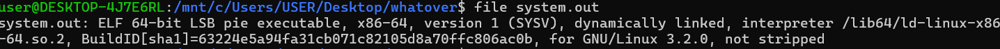

Honestly, this is the kind of challenge where I could just open Ghidra and look at what's happening, but I always run these commands first just to get a feel for it.

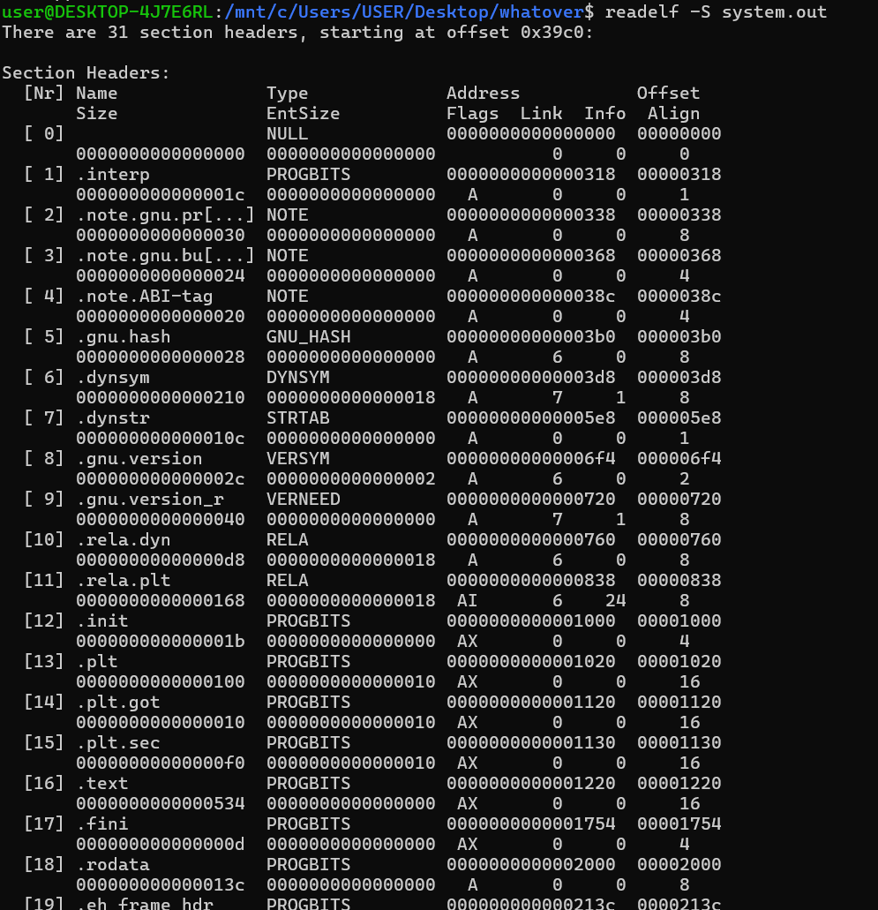

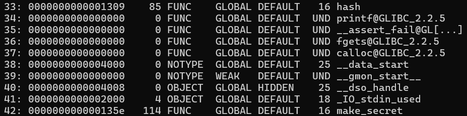

We can see two functions, `hash` and `make_secret`, by reading the symbol table.

Once we know what we're working with and which sections and symbols it has, we run the file.

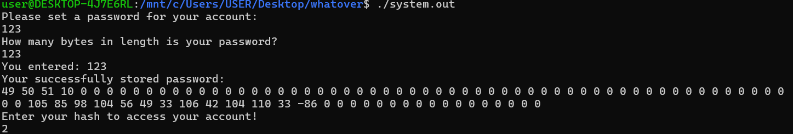

Looks normal. You can try `ltrace`, but you probably won't find anything.

## First approach: the debugger

There are two approaches to this exercise. I was looking directly for a secret or token creation, but I ended up figuring out that the only input that actually matters is the last one.

Since you can see some variables in Ghidra, I used a debugger to look at a comparison, and it actually works.

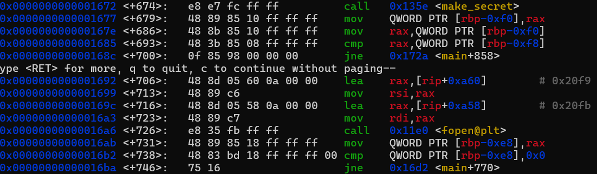

Basically, I make a hypothesis: if you look at the code, there's just an `if` that reads the flag. If you read the registers storing the data, you'll see one holds a bunch of hex digits and the other just a single digit.

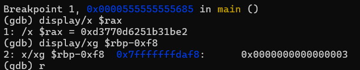

To me it looks obvious that it comes from some input, and then you realize it actually takes the hash number you're typing in.

Then I asked myself whether this is dynamic, i.e. whether the hex value we don't know changes. But if you try different inputs it doesn't change, so it's hardcoded.

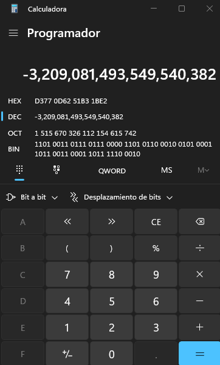

I'm not showing all the pseudocode yet, because at the end I'll do a quick review with the other way to solve it. In short: you can insert hex numbers, so you need to enter the decimal form of that value.

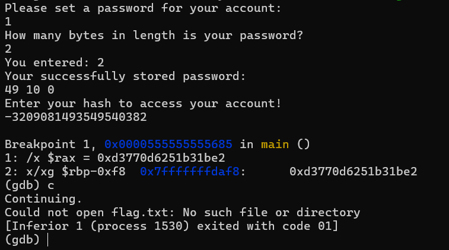

And that's it, but this is the approach I took at first. Then I realized it isn't the most "reversing" way to solve it.

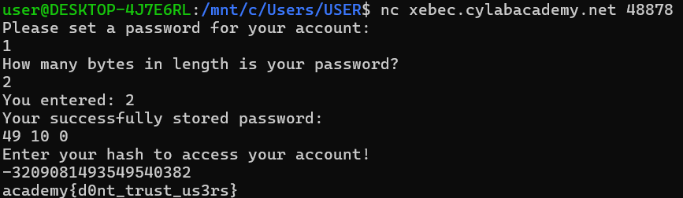

## Understanding the code

I don't want to spend too long here, so we won't go line by line, just the important parts.

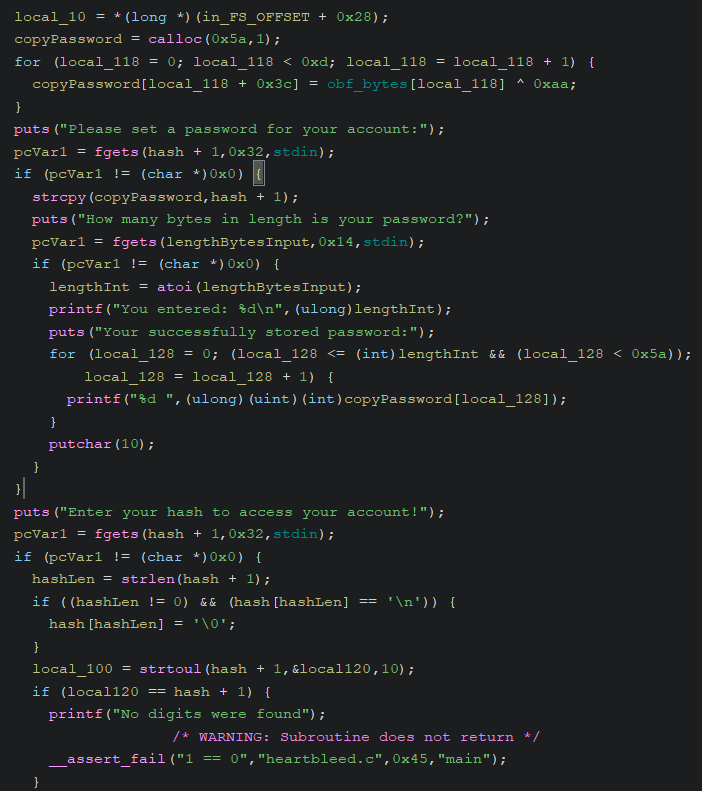

`copyPassword` is basically a buffer: it allocates 90 bytes, then a loop fills part of it starting at offset 60, adding 13 bytes. The important part is that `obf_bytes` is a variable whose contents we can't see, and it's XORed with `0xaa`.

How do we get it? Reading the code, the `for` condition looks interesting:

```c
local_128 < 0x5a
```

The program trusts us with the length of the input we entered earlier. So what happens when we pass a number much longer than what we actually entered?

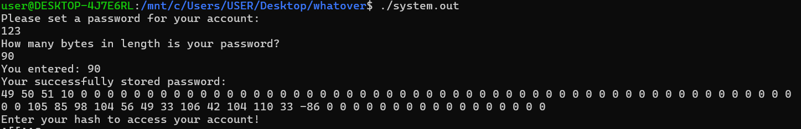

Of course, you can see all the memory up to index `0x5a`, but that doesn't matter, because you've already read the `obf_bytes`.

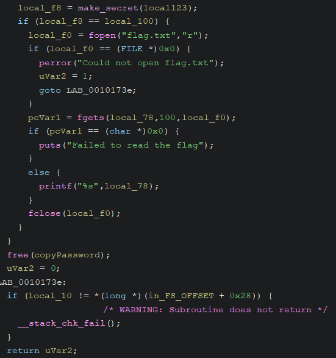

Here we finally see what the program needs to unlock the flag, and this leads us to `make_secret`, because we need to know what that function returns.

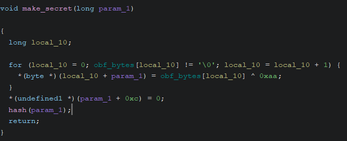

Then we go into `make_secret`, where the argument passed (`local123`) stores the `obf_bytes`, which, conveniently, are the same `obf_bytes` we can read through the vulnerability. It then passes `param_1` to the `hash` function.

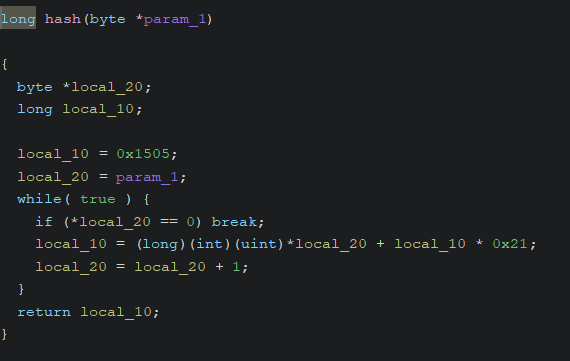

Seeing that `local_10` starts at `0x1505`, it's multiplied by `0x21` and the result is added to our current `obf_bytes` byte. That result feeds the next iteration, repeating the same operation until it has gone through every byte, and finally returns the value. (It's a classic DJB2 hash.)

Now we write a Python script to compute this value:

```python
obf_bytes = [105, 85, 98, 104, 56, 49, 33, 106, 42, 104, 110, 33]

res = 0x1505
for b in obf_bytes:
    res = (b + res * 0x21) & 0xFFFFFFFFFFFFFFFF

print(hex(res))
```

With that, it returns the flag.

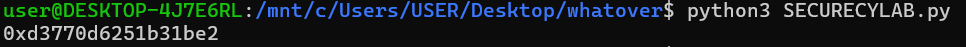
